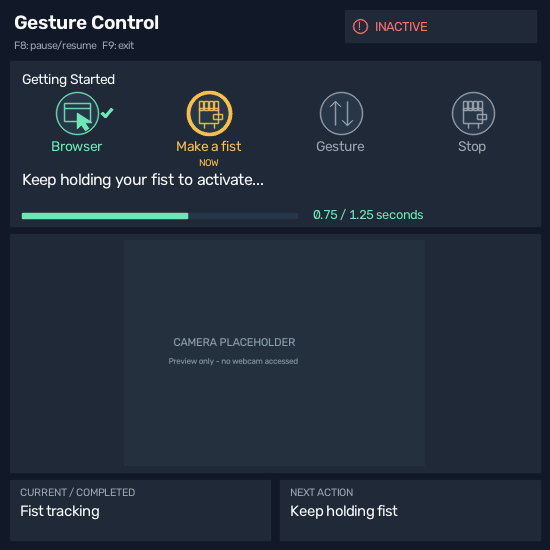

# Gesture Control

A Windows OpenCV application that uses webcam hand gestures to scroll a supported
browser. Run `main.py` in a Python environment with OpenCV, MediaPipe, and NumPy
installed; keep `hand_landmarker.task` in the working directory.

## Interface and controls

The resizable preview opens with a compact 550 x 550 image area (about 20% of a
1651 x 928 display, plus the native title bar/borders). Text and antialiased icons
are drawn at the actual viewport size, including after resizing, rather than
scaling a finished large UI image. Windows per-monitor DPI awareness is requested
before window creation to avoid operating-system bitmap enlargement. Only the
webcam is resampled, with its aspect ratio preserved. Extremely small windows
will reduce readability; the intended default is 550 x 550.

A header badge distinguishes **ACTIVE**,
**INACTIVE**, **BROWSER NEEDED**, **NOT READY**, and **PAUSED** using both text and an icon.
The four non-clickable Getting Started steps update from the actual browser,
activation, and scrolling state. The camera remains mirrored with hand landmarks,
and the lower boxes show **CURRENT / COMPLETED** and **NEXT ACTION**.

1. Click a supported browser and move the pointer over its page. Both foreground
   focus and pointer location must be correct.
2. Hold a closed fist for **1.25 seconds** to activate input. The progress bar and
   elapsed/required seconds show the real hold; interrupted tracking resets it.
3. From the fist, raise your index finger and hold for **1 second** to scroll up,
   or raise it and immediately return downward to scroll down. A finger timer
   appears while choosing up.
4. Scrolling continues until you hold a closed fist for **1 second** to stop and
   disable input. Release the fist between registered holds.

**F8** pauses/resumes. **F9** exits globally; **q** exits when the preview has
focus. The preview stays on top without taking focus on startup. Moving the pointer
away from the browser, switching focus, modifier keys, and processing stalls retain
the existing input safeguards. Hand-tracking loss alone does not stop an active scroll.

## UI previews and tests

The [supplied SVG reference](ui-reference/gesture-ui-codex/docs/images/gesture-ui-layout.svg)
and [specification](ui-reference/gesture-ui-codex/GESTURE_UI_CODEX_SPEC.md) are retained
for comparison. The implementation uses OpenCV drawing, without SVG runtime support.

Generated images use a labeled camera placeholder and simulated presentation
states; they are not screenshots of live camera or browser operation.
Run `python preview_ui.py` to regenerate them in an environment with NumPy and
OpenCV. For a live screenshot on Windows, run `python main.py`, focus your browser
with the pointer over its page, perform the desired gesture, and use **Win+Shift+S**
to capture the preview. Opening the snipping overlay may invalidate browser focus,
so generated previews are more reliable for inspecting a specific UI state.

Run `python -m unittest discover -v`. Presentation-state tests require no OpenCV,
MediaPipe, webcam, or Windows input access. Rendering tests run when OpenCV and NumPy
are available, otherwise they are explicitly skipped. Hardware integration still
requires a Windows webcam/browser check.
