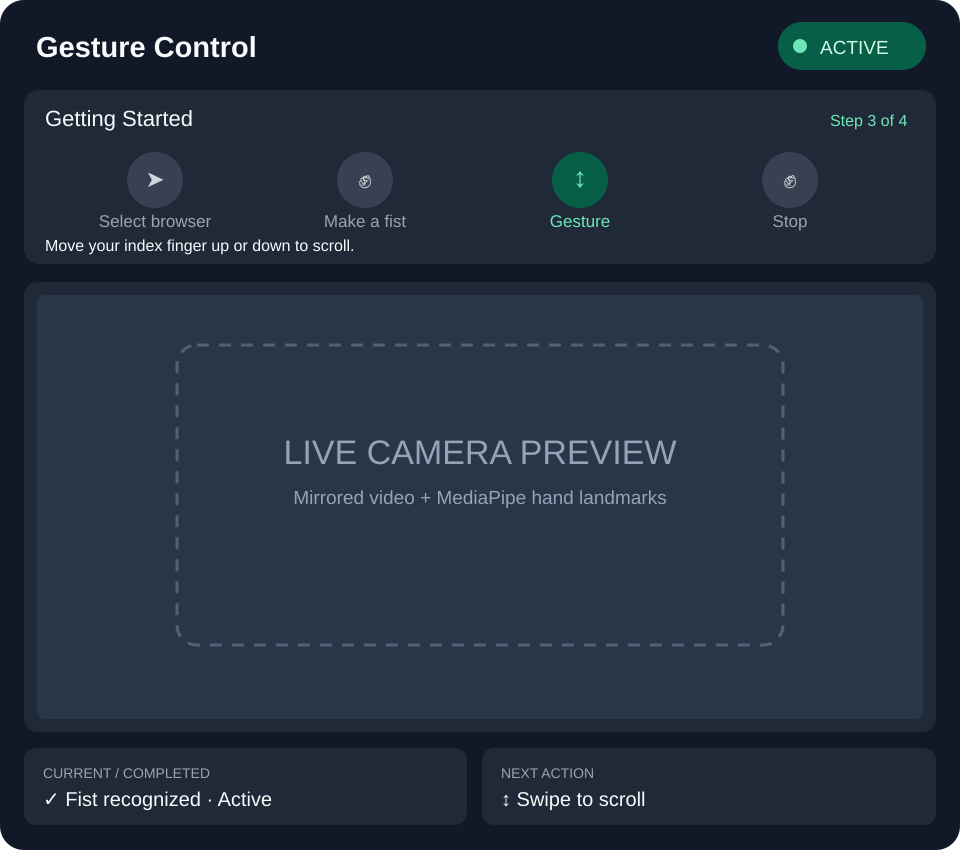

# Codex task: First-time-user interface for Gesture Control

## Goal
Implement an intuitive, lightweight UI **in the existing OpenCV application**, not a new web app. Use the attached visual reference: 

This is a layout reference, not a pixel-perfect requirement. Preserve the working gesture recognition, browser targeting, scrolling, keyboard shortcuts, and webcam feed.

## Read these existing files first
- `main.py`: event loop, pause state, `backend.target()`, fist and finger gesture handling, `scrolling.tick()`, `cv2.imshow()`.
- `camera.py`: mirrored frame preparation, landmark rendering, existing `draw_scroll_feedback()` overlays.
- `gestures.py`: `FistToggle`, `FingerScrollGesture`; fist activation hold is **1.25 seconds**, fist stop hold is **1.0 second**. Reuse `fist.hold_seconds`, `fist.required_hold_seconds`, `fist.fist_visible`, `fist.enabled`, `finger.label`.
- `computer_inputs.py`: `WindowsInput.target()` requires a supported browser **both foreground and under the mouse pointer**; `ScrollController.direction` tracks ongoing scrolling. F8 pause/resume; F9 exit.
- Existing tests: `test_gestures.py`, `test_fist_toggle.py`, `test_finger_scroll.py`, `test_computer_inputs.py`.

## Agreed layout, top to bottom

### 1. Header
- Left: **Gesture Control**.
- Right: status badge, **green `ACTIVE`** only when gesture control is enabled and usable, **red `INACTIVE`** before activation; use a distinct `PAUSED` status when F8 is active. Do not use color alone; show text and an icon.
- If browser targeting becomes invalid, do not misleadingly show an unqualified ACTIVE state; prefer `BROWSER NEEDED` / `NOT READY` and actionable guidance. Preserve the existing underlying fist enable state unless current program logic resets it.

### 2. Getting Started — full-width top panel above webcam
Four horizontal, non-clickable icon steps. No navigation/buttons:
1. **Select browser** — cursor/pointer aimed at a browser window. Mark complete only when `backend.target()` is not `None` (it checks both foreground browser and cursor position).
2. **Make a fist** — closed-fist icon; activates input after the existing 1.25-second hold.
3. **Gesture** — vertical up/down arrow or index-finger gesture; user swipes to start scrolling.
4. **Stop** — same closed-fist icon; deactivates scrolling/control after the existing 1.0-second hold.

Visually distinguish complete, current, and upcoming steps. Highlight the relevant step based on runtime state, **not a simple monotonic counter**: users can lose browser focus, pause, stop, or start again. Do not assume selecting a browser is permanent. Avoid automatically claiming that a step was completed if the application cannot verify it. Step 4 is the action to stop, not a state that must always be reached before returning to step 1.

Under the icons, show **one short, large instruction** appropriate to the current state. Do not add a second tiny explanatory paragraph.

Suggested guidance text (adjust only for clarity):
- No target: `Click your browser and move the pointer over the page.`
- Browser ready, inactive: `Hold a closed fist to activate.`
- Fist being held: `Keep holding your fist to activate…` with a compact hold-progress bar.
- Active, ready: `Move your index finger up or down to scroll.`
- Scrolling: `Scrolling up/down. Hold a fist to stop.`
- Stop hold in progress: `Keep holding your fist to stop…` with progress.
- Paused: `Paused. Press F8 to resume.`
- No hand detected when hand needed: `Show one hand to the camera.` (avoid overriding a more important missing-browser or paused message).

### 3. Webcam — large middle panel
- Preserve the mirrored webcam preview and MediaPipe landmarks.
- Keep the camera area as large as practical, without stretching the image or obscuring hand movement with text.
- Existing scrolling direction arrow may remain if unobtrusive.
- Remove/replace the old large `draw_scroll_feedback()` text strips once their information is represented in the new layout. Avoid duplicated status text.

### 4. Bottom — two compact boxes (no large guidance panel)
- **Bottom left: CURRENT / COMPLETED** — what the user or system has *just accomplished or is currently doing*, e.g. `Browser selected`, `Fist recognized · Active`, `Scrolling down`, `Paused`, `Browser not selected`. Must be truthful, not a fabricated event history.
- **Bottom right: NEXT ACTION** — one concise next step, e.g. `Make a fist`, `Swipe to scroll`, `Hold fist to stop`, `Select browser`, `Press F8 to resume`.
- These are **not** a last-command log, and there should be **no last-command box**.
- Keep the text readable at the intended window size; if space is tight, increase window dimensions or simplify labels instead of shrinking to illegibility.

## State derivation and behavior
Compute a small, explicit **presentation state** from existing application variables. Prefer a pure function (e.g. `derive_ui_state(paused, target_available, fist_enabled, fist_visible, hold_seconds, required_hold_seconds, scrolling_direction, hand_count, finger_label)`) that returns a dataclass or simple object with header status, highlighted step, main guidance, current/completed message, next-action message, and progress. Do not let rendering modify gesture or scrolling state.

Precedence: paused -> missing browser target -> scrolling/stop hold -> inactive/activation hold -> active/gesture readiness. Re-check precedence against the actual control loop, especially because target changes currently reset `fist` and cancel scrolling. The UI must match the actual behavior rather than promise impossible actions.

Keep the distinction between `fist.enabled` (gesture control toggled on), `target is not None` (browser eligible), `scrolling.direction` (continuous scrolling), and `paused` (F8). Do not conflate these. During active scrolling, the fist is a **stop action**; do not display swipe instructions as the next action.

## Visual design
- Dark neutral background (`#111827`), slightly lighter panels (`#1F2937`), light text (`#F9FAFB`), muted secondary text (`#9CA3AF`).
- Green (`#6EE7B7`) for active/recognized, red (`#F87171`) for inactive/not ready, amber for caution/paused if useful. Use text + icon in addition to color.
- Consistent alignment, ample padding, readable text; no decorative animation or distracting flashing.
- Use simple icons drawn with OpenCV primitives or an optional local image asset. Do not introduce a heavy UI dependency unless needed. Icons must be understandable without color; an outlined pointer/browser, closed fist, up/down gesture, closed fist.
- The attached SVG mockup is an illustrative reference. It can be embedded in the repository as documentation, but do not require SVG support in the runtime.

## Implementation approach
1. Inspect the repository before editing and summarize the minimal changes you intend to make.
2. Prefer a new `ui.py` (or `overlay.py`) containing layout drawing and pure state mapping. Keep `camera.py` focused on frame acquisition and landmarks. Integrate UI calls in `main.py`.
3. Render a **composed output frame** with a top header/getting-started area, middle camera feed, and bottom two status boxes. Use NumPy/OpenCV; do not resize the camera non-uniformly. Consider a larger initial preview than the existing `480 × 360` because the new interface adds panels; keep the window resizable.
4. Keep camera capture resolution and MediaPipe detection coordinates correct; draw landmarks on the camera image before composing the overall interface.
5. Preserve `backend.pin_preview(WINDOW_TITLE)`, `cv2.waitKey`, window-close handling, keyboard shortcuts, browser focus behavior, fist timing, and scrolling semantics.
6. Provide hold-progress feedback during both fist activation and stop, using the real timing values. Do not invent a progress percentage when no fist is being observed.
7. Add tests for presentation-state precedence and representative transitions (no browser, ready browser, activation hold, active, scrolling, stop hold, pause, lost target). Avoid hardware/camera requirements in unit tests.
8. Run available tests; report what passed, failed, or could not run due to OS/dependencies. Do not claim Windows hardware integration was tested if it was not.

## Acceptance criteria
- A first-time user can identify where to point the cursor, how to activate, how to scroll, and how to stop from the visible UI.
- The top steps update from actual runtime conditions and are not clickable.
- Header status accurately reflects usability and control activation.
- Bottom-left reports current/completed status; bottom-right reports next action.
- No last-command box and no tiny redundant explanation under Getting Started.
- Existing scrolling, browser gating, F8/F9, fist toggling, and gesture detection still work.
- No misleading `ACTIVE` when paused or without an eligible browser.
- New UI state logic is tested independently of OpenCV and MediaPipe where feasible.

## Deliverables
- Updated Python source and tests.
- A brief README section explaining the interface and controls.
- Screenshot(s) of the implemented UI if practical, or instructions to capture them on Windows.
- Short summary of changed files and any unresolved issues.

**Scope boundary:** This is an interface iteration, not a rewrite of gesture recognition or input handling. Ask before changing gesture definitions, scroll mechanics, or browser eligibility rules.
